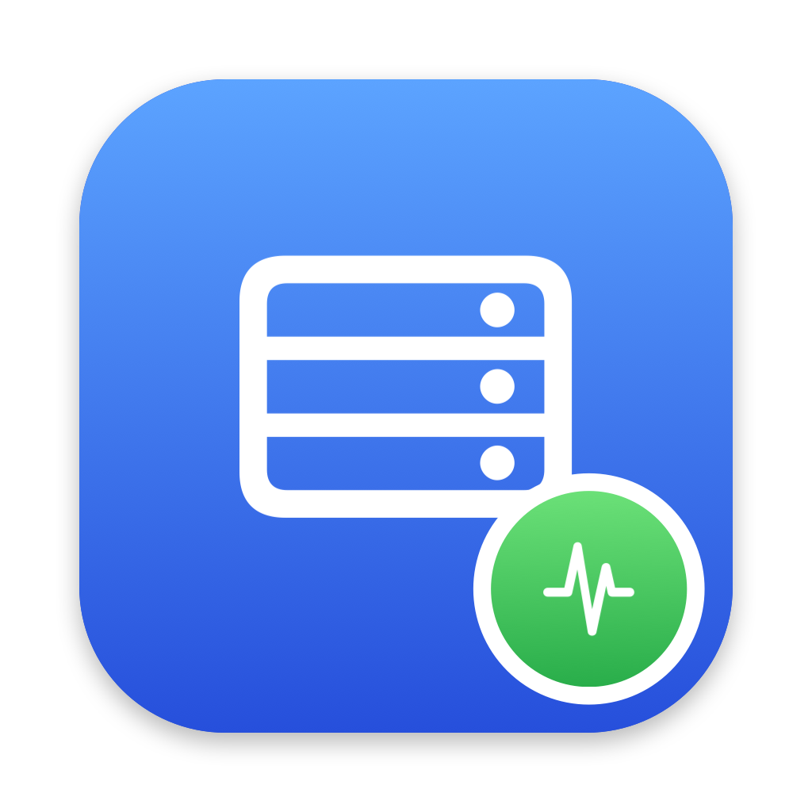
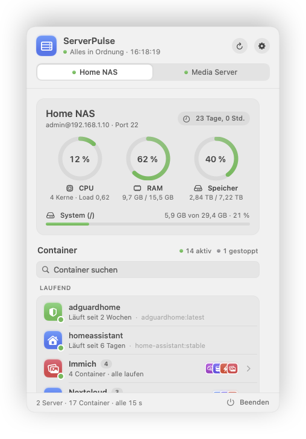
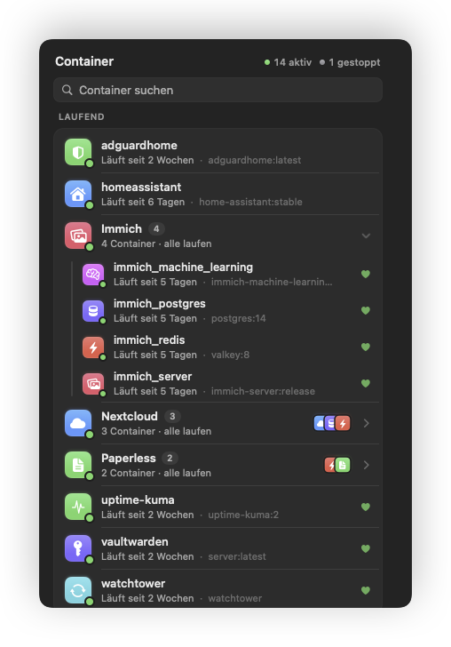

<p align="center">
  
</p>

<h1 align="center">ServerPulse</h1>

<p align="center">
  A native macOS menu bar app to keep an eye on your Linux servers, NAS boxes and Docker containers – over plain SSH.
</p>

<p align="center">
  
  
</p>

## Features

- **System at a glance** – CPU, RAM, storage pools (`/`, `/volume1`, `/mnt`) and uptime as live gauges.
- **Docker containers** – grouped by Docker Compose project, collapsible, searchable, with health status.
- **Control containers** – start, stop, restart and view logs, for single containers or whole Compose stacks.
- **Multiple servers** – switch between hosts with one click; the menu bar icon turns into a warning sign when a host is unreachable or a container crashed.
- **No agent, no account** – nothing to install on your servers. ServerPulse uses your existing SSH key and `/usr/bin/ssh`.
- **Native and lightweight** – Swift 6 and SwiftUI, zero third-party dependencies, about 1.5 MB.

Tested with UGREEN NAS (UGOS), but any Linux host with `/proc` and Docker works.

> The app's interface is currently in German.

## Installation

### Download

1. Download the latest `ServerPulse-x.y.z.dmg` from the [Releases page](../../releases/latest).
2. Open it and drag **ServerPulse** into **Applications**.
3. ServerPulse is not notarized by Apple, so macOS blocks the first launch. Open **System Settings → Privacy & Security** and click **Open Anyway**.

Every release is built by [GitHub Actions](../../actions/workflows/release.yml) directly from the tagged source, and the SHA-256 checksum is published next to the DMG.

### Homebrew

Each release also ships a ready-made cask (`serverpulse.rb`). The install command is listed in the release notes.

### Build from source

Requires Xcode 16 or later (Swift 6).

```bash
git clone https://github.com/cozmr-dev/ServerPulse.git
cd ServerPulse
./build.sh          # → build/ServerPulse.app
./build.sh dmg      # → build/ServerPulse-<version>.dmg
open build/ServerPulse.app
```

For development, `swift run` also works.

## Server setup

ServerPulse logs in with an SSH key only (`BatchMode=yes`), so it never hangs on a password prompt.

1. **Enable SSH** on the server (UGREEN: *Control Panel → Terminal → SSH*).
2. **Copy your public key** to the server:
   ```bash
   ssh-copy-id -p 22 -i ~/.ssh/id_ed25519.pub user@your-server
   ```
   If your key has a passphrase, add it to the macOS keychain once:
   ```bash
   ssh-add --apple-use-keychain ~/.ssh/id_ed25519
   ```
3. **Allow Docker without sudo** (optional, needed for container data and actions):
   ```bash
   sudo usermod -aG docker <user>
   ```
4. In ServerPulse open **Settings → Server hinzufügen**, enter host, port and user, then click **Verbindung testen**.

**Troubleshooting**

| Message | Fix |
| --- | --- |
| *Anmeldung abgelehnt (Permission denied)* | Public key not on the server, or the key has a passphrase that is not in the ssh-agent. |
| *Could not chdir to home directory* (during `ssh-copy-id`) | The user has no home folder. Enable the user home service on the NAS or create `/home/<user>`. |
| *Keine Berechtigung für Docker* | Add the user to the `docker` group (step 3). |

## How it works

Every refresh runs **one** SSH session per host and pipes a small POSIX shell script to `sh -s`. It reads `/proc/stat`, `/proc/meminfo`, `/proc/loadavg`, `/proc/uptime`, `df` and `docker ps`, and returns clearly separated sections that the app parses. Container actions run `docker start|stop|restart|logs` the same way. Container IDs are validated before they reach the remote shell.

Your server list is stored locally in `UserDefaults`. ServerPulse sends no telemetry and talks to nothing but your own servers.

## Project structure

```
Sources/ServerPulse/
  App/         App entry point (MenuBarExtra)
  Models/      ServerHost, SystemStats, DockerContainer, ContainerGroup, …
  Services/    SSHService, ProcessRunner, RemoteScripts, StatusParser, HostStore
  ViewModels/  MonitorViewModel, LogViewModel
  Views/       Menu bar window, settings, log window, shared components
scripts/       App icon generator, Homebrew cask generator
```

## Contributing

Issues and pull requests are welcome. Please keep the project dependency-free (Apple frameworks only) and make sure `./build.sh` finishes without warnings.

## License

[MIT](LICENSE)
